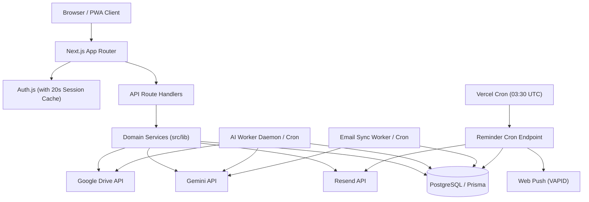
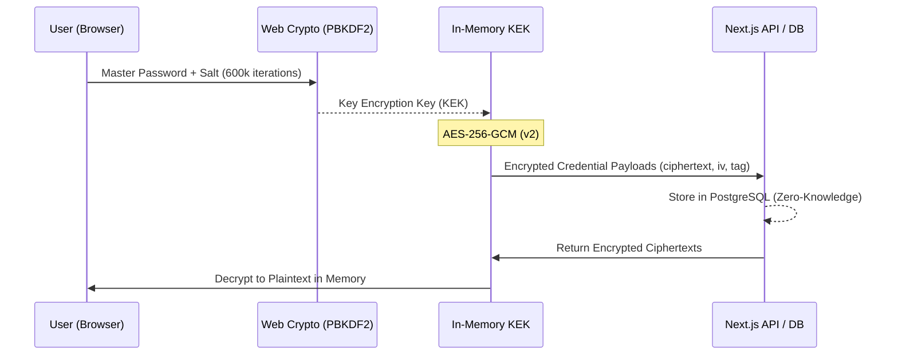

# Architecture, Integrations & Security

## 1. Runtime Topology & System Architecture

Vaulty is a private personal and family information workspace built on the Next.js App Router, PostgreSQL, Google Drive, and Google Gemini.

- **Web Application:** Next.js 16.4.5 App Router, React 19.3.1, TypeScript strict mode.
- **Authentication & Sessions:** Auth.js v5 beta with Prisma adapter, Google OAuth and email magic-link providers, JWT session strategy with 20-second in-memory session validation caching (`session-cache.ts`).
- **Database & Persistence:** PostgreSQL via Prisma 6.3.
- **File Storage:** Google Drive API using user-connected OAuth tokens. Google Drive is the primary concrete storage provider.
- **AI Engine:** Google Gemini via `@google/genai` (`gemini-3.6-flash` default).
- **Email Delivery:** Resend API (`resend` SDK) for transactional emails, magic links, family invitations, and reminder digests; Resend Inbound Webhooks for email sync forwarding.
- **Browser Push:** Web Push via `web-push` using VAPID keys and service worker (`public/sw.js`).
- **Styling & UI Primitives:** Tailwind CSS v4, semantic CSS variables, Lucide icons, `next-themes`, and custom Microsoft Fluent-inspired controls (`CommandBar`, `FolderTreeSelect`).
- **Rich Text Canvas:** TipTap v3 (`@tiptap/react`, `@tiptap/starter-kit`, `@tiptap/markdown`, `@tiptap/extension-task-item`, `@tiptap/extension-task-list`) with bidirectional Markdown synchronization and `react-markdown` preview rendering.
- **Background Workers:**
  - AI Document Queue: Persisted PostgreSQL queue with standalone worker (`yarn ai:worker`) or authenticated cron (`/api/cron/ai-worker`).
  - Email Transaction Sync: Mailbox crawler and transaction classifier with standalone daemon (`yarn worker:email`) or authenticated cron (`/api/cron/email-sync`).
  - Reminders & Expiries: Scheduled processor endpoint (`/api/cron/reminders`) triggered daily at 03:30 UTC via `vercel.json`.

---

## 2. Route Groups & App Shell Structure

- `/`: Public marketing and landing page.
- `src/app/(app)/layout.tsx`: Authenticated application shell wrapping all protected views with `AppLockProvider`, `PasswordVaultProvider`, `UploadProvider`, `AppShell`, `ErrorBoundary`, and `AppLockScreen` (`force-dynamic`).
- `src/app/layout.tsx`: Root wrapper containing `ThemeProvider`, `SessionProvider`, `FeedbackProvider`, and global `SiteFooter`.
- `/auth/*`: Sign-in, verification request, and error pages (`/auth/signin`, `/auth/verify-request`, `/auth/error`).
- `/share/[token]`: Public document share route; validates share tokens, passwords, expiration, and maximum view counts with signed session cookies.
- `/api/passwords/recovery/verify` & `/api/passwords/recovery/rekey`: Token-gated recovery endpoints authorized via one-time reset tokens (or active sessions), exempted from standard session redirection in `proxy.ts`.
- `src/proxy.ts`: Middleware boundary enforcing session authentication for protected paths, validating session version (defaulting unversioned legacy tokens to 0 so revocations invalidate them), and setting double-submit CSRF cookies.

---

## 3. External Integrations

### Google OAuth & Google Drive Storage

- Configured in `src/auth.ts`, `src/lib/google-drive/oauth.ts`, and `src/lib/storage/drive-provider.ts`.
- Uses `GOOGLE_CLIENT_ID` and `GOOGLE_CLIENT_SECRET`.
- Scopes: `openid`, `email`, `profile`, `drive.file`, and `drive.readonly`.
- Original document binaries and generated AI artifacts live in the user's Google Drive under a structured hierarchy:
  `Vaulty/Docs`, `Vaulty/Summary`, `Vaulty/Interpretation`, `Vaulty/Text`.
- Drive OAuth refresh tokens are encrypted at rest with AES-256-GCM using a key purpose-derived from `AUTH_SECRET`.
- Sync logic in `src/lib/sync/sync-engine.ts` tracks Drive file/folder metadata, records sync events, and reconciles conflicts.

### Google Gemini AI

- SDK: `@google/genai` with `GEMINI_API_KEY` and model `GEMINI_MODEL` (defaults to `gemini-3.6-flash`).
- Used for document extraction, Markdown summaries, informational interpretations, structured date extraction, grounded chat (`/api/chat`), and financial email transaction classification.
- Document prompts strictly forbid fabricated facts and mandate explicit uncertainty disclaimers. Medical interpretations are informational only (no medical diagnoses or prescription changes).
- **Data Boundary:** Credential vault plaintext is never transmitted to Gemini. Only uploaded document contents and email text payloads are sent to Gemini.

### Email (Resend API & Inbound Webhooks)

- Uses `RESEND_API_KEY`, `RESEND_INBOUND_WEBHOOK_SECRET`, `INBOUND_EMAIL_DOMAIN`, and `EMAIL_FROM`.
- Handled directly via the official `resend` package.
- `src/lib/email.ts` dispatches application emails, family invitations, and daily reminder digests.
- **Inbound Webhook (`/api/webhooks/resend/inbound`):** Receives forwarded emails via Svix-signed webhooks, resolves recipient addresses (`username+docs@vaulty.mnilay.com`), automatically cracks password-protected statement PDFs via `PdfPasswordSettings`, stages binary attachments in `InboundEmailAttachment`, and runs multi-module classification for documents, reminders, and wealth transactions without mailbox OAuth grants.

### Microsoft Entra (Outlook Sync)

- Configured in `src/lib/outlook/oauth.ts`.
- Uses `MICROSOFT_CLIENT_ID`, `MICROSOFT_CLIENT_SECRET`, and `MICROSOFT_TENANT_ID`.
- Scopes: `openid`, `offline_access`, `Mail.Read`.
- Tokens are encrypted at rest with AES-256-GCM.

### Web Push Notifications

- Implemented via `web-push` using VAPID keys (`NEXT_PUBLIC_VAPID_PUBLIC_KEY`, `VAPID_PRIVATE_KEY`, `WEB_PUSH_SUBJECT`).
- Service worker at `public/sw.js` handles push events and notification clicks.
- Client subscriptions stored in `PushSubscription` with encrypted endpoint auth keys.

---

## 4. Security & Cryptography Model

### Credential Vault Envelope Encryption

- **Algorithm:** Version 2 envelope encryption using AES-256-GCM.
- **Key Derivation:** Web Crypto PBKDF2-HMAC-SHA256 with 600,000 iterations and a 16-byte cryptographically random salt.
- **Zero-Knowledge Guarantee:** Master passwords, plaintext credentials, and derived KEKs are never sent to or stored on the server.
- **Brute-Force Lockout Defense:** `PasswordVault.failedAttempts` and `PasswordVault.lockedUntil` enforce a 15-minute lockout after 5 consecutive failed unlock or password change attempts.
- **App Lock Cross-Device PIN Sync:** Setting an App Lock PIN wraps the KEK using `sha256(pin)` as an AES-KW / AES-GCM wrapping key and stores `appLockPinHash` and `appLockWrappedKey` on `PasswordVault`.

### In-Memory Decryption & Memory Safety

- Password-protected PDF statements are cracked and parsed in-process using `pdfjs-dist`; attachment bytes and passwords are never transmitted to external APIs.
- Memory budgets: scrypt operations enforce `maxmem: 128MB`; buffer conversions avoid spread operators; ZIP exports enforce a 50MB per-file and 200MB total ceiling.

### CSRF & Authorization

- Double-submit CSRF cookie validation using HMAC-SHA256 signatures (`x-csrf-token` header vs `csrf-token` cookie) on all mutations.
- Distributed sliding-window rate limiting backed by PostgreSQL (`SecurityRateLimit`).
- All family and shared resource routes verify ownership or membership permissions server-side on every request.
