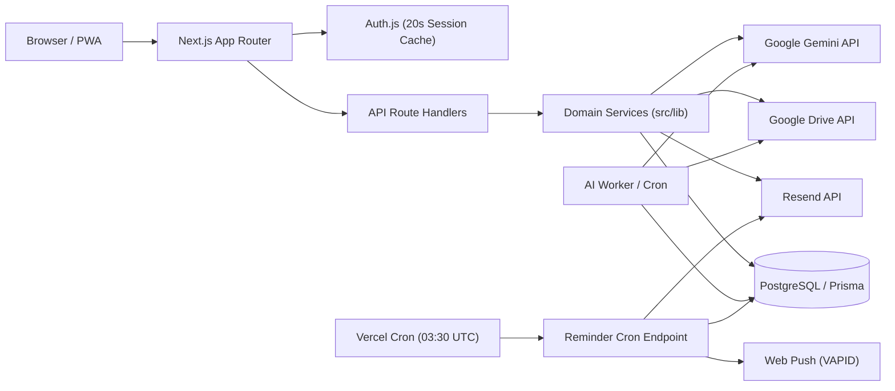

# Vaulty

**A private personal and family workspace for your important documents, credentials, wealth records, and reminders.**

Vaulty brings personal information into one place: organize important files, understand them with AI, keep track of accounts and transactions, manage a client-side encrypted credential vault, share selected areas with family, and stay ahead of important dates.

> **Project status:** Active development. Review the [known limitations](.agents/PRODUCT.md) and [security notes](.agents/ARCHITECTURE.md#4-security--cryptography-model) before deploying with real personal data.

---

## Contents

- [Features](#features)
- [Screens and Modules](#screens-and-modules)
- [Technology Stack](#technology-stack)
- [Architecture](#architecture)
- [Getting Started](#getting-started)
- [Environment Configuration](#environment-configuration)
- [Available Scripts](#available-scripts)
- [Database and Migrations](#database-and-migrations)
- [Background Processing and Reminders](#background-processing-and-reminders)
- [Documentation for Developers and AI Agents](#documentation-for-developers-and-ai-agents)
- [Security and Privacy](#security-and-privacy)
- [Testing](#testing)
- [Contributing](#contributing)
- [License](#license)

---

## Features

### Document Management & Scanning

- Upload PDF, JPEG, PNG, and WebP files up to 50 MiB.
- **Hierarchical Folder Picker (`FolderTreeSelect`):** Interactive tree dropdown component across document upload, camera scanning, document properties/move modal, library filtering, and email sync staging. Features collapsible/expandable branches, folder depth indentation guides, and instant search with auto-expanded matching branches.
- **Fluent Command Bar (`CommandBar`):** Flush, square-edged (`rounded-none`) buttons with crisp hover feedback and single grid/list view toggle.
- **Mobile Camera Capture & Perspective Stitcher:** Quick native camera capture (`capture="environment"`), interactive 4-corner perspective crop with Heckbert projective transformation, aspect ratio presets (Free, A4, ID Card, Square), 90° rotation, document enhancement filters (Document B&W, Grayscale, Color), multi-page scanning with page reordering, client-side PDF stitching (`pdf-lib`), and automatic client-side compression before direct Google Drive upload.
- **Append Pages to Existing Google Drive Documents:** Append new scanned or uploaded pages directly to existing PDF or image documents via `POST /api/documents/[id]/append-page`, stitching PDFs and re-triggering AI extraction.
- **Sharing:** Public share links with optional password protection (scrypt with 128MB memory cap), expiration, and view limits. Read-only folder sharing with cascading permissions.

### AI Document Understanding

- Extract document text and generate Markdown summary and interpretation using Google Gemini (`gemini-3.6-flash`).
- Structured date extraction: populates `expiryDate` ($\ge 0.85$ confidence with cited evidence) and auto-generates deduplicated `Reminder` entries for important dates.
- Interactive in-document Q&A grounded strictly on extracted text.
- Store original documents and generated AI artifacts in Google Drive under `Vaulty/Docs`, `Summary`, `Interpretation`, and `Text`.

### Credential Vault & Two-Factor Authenticator (2FA)

- Client-side envelope encrypted credential vault (Version 2 AES-256-GCM with 600,000 PBKDF2 iterations).
- Built-in two-factor authenticator (TOTP / 2FA) generating live 6-digit codes with animated 30s countdown timer (RFC 6238).
- Scan QR codes via live camera, image upload (`jsQR`), or manual Base32 key entry.
- Brute-force lockout defense: 15-minute lockout after 5 consecutive failed unlock attempts.
- Centralized App Lock with cross-device 4-digit PIN sync and transparent vault key un-wrapping.
- Offline zero-knowledge recovery key and security question re-keying.

### Notes & Checklists

- **Tri-Mode Canvas (`NoteEditor`):**
  - **Rich Text Mode:** TipTap-powered editor supporting Bold, Italic, Strikethrough, Highlight (yellow marker), Headings (H1, H2, H3), Bulleted (`<ul>`) and Numbered (`<ol>`) lists, Blockquotes, Tables, and Dividing lines (`<hr>`).
  - **Markdown Mode:** Direct raw Markdown source editing in a monospaced font with keyboard shortcuts (`Ctrl+B`, `Ctrl+I`, `Tab` indentation).
  - **Preview Mode (`NoteMarkdown`):** Rendered GFM view using `react-markdown` with support for `data:image/*` and `blob:*` image previewing.
- **Interactive Checkboxes / To-Dos:** Inline flex rows (`display: flex; flex-direction: row; align-items: flex-start;`) ensuring checkboxes and text always appear on the exact same row.
- **Images:** Pasting screenshots from clipboard (`Ctrl+V`), drag & drop, and toolbar file selection, converting to Base64 data URLs.
- **Color Accents & Organization:** 7 color themes, sticky top pinning, and debounced auto-saving.
- **Family Sharing:** Granular `shareNotes` permission allowing family members to view read-only pages.

### Wealth Management & Multi-Currency Ledger

- Track bank accounts, credit cards, investments, loans, deposits, cash, and other asset/liability types.
- Record transactions and recalculate running balances chronologically (`balanceAfter` and `currentBalance`).
- Summaries group assets, liabilities, and net worth independently by ISO currency (no mixed-currency conversion).
- Upload, parse, review, and import financial statements (CSV, XLSX, and password-protected PDF statements via `pdfjs-dist`).
- Merge duplicate accounts of identical currency with atomic transaction reassignment.

### Email Synchronization & Multi-Module Discovery Engine

- Connect Gmail (`gmail.readonly`), Outlook (`Mail.Read`), or use **Inbound Forwarding** (e.g. `<username>+<token>@vaulty.mnilay.com`) via Resend Inbound Webhooks.
- Multi-module scoring and structured Gemini classification categorize emails into:
  - **Wealth Transactions:** High-confidence matches ($\ge 0.90$) auto-import; others enter review queue.
  - **Important Documents:** Invoices, receipts, tax documents staged with 1-click vault import.
  - **Reminders & Due Dates:** Bill payments, renewals, and EMI due dates staged or auto-created.
- Auto-cracks password-protected financial statement PDFs using configured `PdfPasswordSettings` templates locally.

### Reminders & Proactive Notifications

- Track document expiries, wealth account expiries, credit card payment due days, and custom reminders.
- Unified view toggle between List view (`/reminders`) and monthly Calendar view (`/reminders/calendar-view`).
- Multi-channel delivery: in-app notification center (with `hasLoaded` skeleton loaders), email digests via Resend, and browser Web Push (`public/sw.js`).
- Evaluated daily at 03:30 UTC via `GET /api/cron/reminders` (`vercel.json`).

### Family Sharing

- Invite family members by email with granular module flags (`shareDocuments`, `shareWealth`, `shareCredentials`, `shareReminders`, `shareNotes`).
- Strict server-verified read-only access and zero-knowledge public/wrapped credential keys (`FamilyCredentialKey`).
- All family routes are rate-limited via PostgreSQL-backed `SecurityRateLimit`.

### AI Chat

- Conversational assistant grounded in the user's authorized document vault content via Google Gemini.

---

## Screens and Modules

| Route                       | Purpose                                                           |
| :-------------------------- | :---------------------------------------------------------------- |
| `/`                         | Public product landing page                                       |
| `/dashboard`                | Personal workspace overview and upcoming attention items          |
| `/documents`                | Document overview and quick actions                               |
| `/documents/library`        | Document library (owned vault documents, FolderTreeSelect, views) |
| `/documents/[id]`           | Document detail (preview, AI summary, dates, append pages, Q&A)   |
| `/folders`, `/folders/[id]` | Hierarchical folder navigation and folder sharing                 |
| `/credentials`              | Credential vault (App Pass, Bank Pass, Authenticator)             |
| `/credentials/account`      | App login credentials subroute                                    |
| `/credentials/bank`         | Bank credentials subroute                                         |
| `/notes`                    | Tri-mode notes canvas (rich text, markdown, preview, to-dos)      |
| `/wealth`                   | Wealth overview and net worth by currency                         |
| `/wealth/accounts`          | Wealth accounts list, filtering, and bulk operations              |
| `/wealth/accounts/[id]`     | Account chronological transaction ledger and running balances     |
| `/wealth/transactions`      | Global transaction ledger and category filters                    |
| `/wealth/statements/import` | Statement upload, PDF password cracking, and review flow          |
| `/email-sync`               | Multi-module inbox automation (Gmail, Outlook, Inbound Webhooks)  |
| `/reminders`                | Custom reminders and preferences (list view)                      |
| `/reminders/calendar-view`  | Reminders monthly visual calendar view                            |
| `/notifications`            | In-app notification center and Web Push toggle                    |
| `/family`                   | Family invitations and shared module management                   |
| `/family/notes`             | Read-only notes shared by family members                          |
| `/shared`                   | Documents and folders shared directly with the user               |
| `/search`                   | Scored full-page search across document metadata and content      |
| `/chat`                     | Document-grounded AI conversational assistant                     |
| `/settings`                 | Profile, App Lock, recovery setup, Drive, PDF passwords, takeout  |
| `/share/[token]`            | Token-authenticated public document viewer with optional password |

---

## Technology Stack

- **Framework:** Next.js 16.4.5 App Router
- **Language:** TypeScript 5.9 (strict mode)
- **UI:** React 19.3.1, Tailwind CSS v4, Lucide React
- **Rich Text & Markdown:** TipTap v3, `react-markdown`, `remark-gfm`
- **Theme:** `next-themes` (light and dark mode)
- **Authentication:** Auth.js v5 beta, Google OAuth, email magic links
- **Database / ORM:** PostgreSQL and Prisma 6.3
- **File Storage:** Google Drive API
- **AI Engine:** Google Gemini (`@google/genai`)
- **Email Delivery:** Resend API (`resend` SDK)
- **Browser Push:** `web-push` (VAPID signing and RFC 8291 payload encryption)
- **Automated Testing:** Vitest (36 test suites / 273 tests), Playwright
- **Package Manager:** Corepack with Yarn 4.5.3

---

## Architecture



---

## Getting Started

### Prerequisites

- Node.js version supported by Next.js 16.4.5 (v20+ recommended).
- Corepack enabled with Yarn 4.5.3.
- A PostgreSQL database instance (local or Neon serverless).
- Google Cloud Console OAuth credentials.
- Google Gemini API key.
- Resend API key for email delivery.
- Microsoft Entra credentials (only if Outlook mailbox sync is needed).

### 1. Clone and Install

```bash
git clone <your-repository-url>
cd vaulty

corepack enable
yarn install
```

### 2. Configure Environment

```bash
cp .env.example .env
```

Fill in required variables (see [Environment Configuration](#environment-configuration) and [.agents/DEVELOPMENT.md](.agents/DEVELOPMENT.md)).

### 3. Generate Prisma Client & Apply Migrations

```bash
yarn prisma generate
yarn db:migrate
```

### 4. Start Development Server

```bash
yarn dev
```

Open `http://localhost:3000`.

---

## Environment Configuration

| Variable                                          | Required | Description                                                                        |
| :------------------------------------------------ | :------: | :--------------------------------------------------------------------------------- |
| `DATABASE_URL`                                    | **Yes**  | PostgreSQL connection string                                                       |
| `AUTH_SECRET`                                     | **Yes**  | Auth.js secret (32+ chars in prod); derives refresh token and push keys            |
| `NEXTAUTH_URL`                                    | **Yes**  | Canonical application URL and OAuth callback base                                  |
| `GOOGLE_CLIENT_ID` / `GOOGLE_CLIENT_SECRET`       | **Yes**  | Google sign-in, Drive, and Gmail OAuth                                             |
| `GEMINI_API_KEY`                                  | **Yes**  | Google Gemini API key                                                              |
| `GEMINI_MODEL`                                    |    No    | Gemini model override (default: `gemini-3.6-flash`)                                |
| `RESEND_API_KEY`                                  |    No    | Resend API key for notifications, magic links, and invitations                     |
| `EMAIL_FROM`                                      |    No    | Verified sender address (e.g. `noreply@vaulty.app`)                                |
| `CRON_SECRET`                                     |    No    | Bearer secret protecting `/api/cron/*` endpoints (32+ chars in prod)               |
| `CSRF_SECRET`                                     | **Prod** | Dedicated HMAC-SHA256 CSRF signing secret (32+ chars)                              |
| `RESEND_INBOUND_WEBHOOK_SECRET`                   |    No    | Svix webhook signing secret from Resend Inbound                                    |
| `INBOUND_EMAIL_DOMAIN`                            |    No    | Domain for inbound routing (e.g. `vaulty.mnilay.com`)                              |
| `PDF_PASSWORD_SETTINGS_SECRET`                    |    No    | AES-256-GCM encryption key for PDF password settings (falls back to `AUTH_SECRET`) |
| `MICROSOFT_CLIENT_ID` / `MICROSOFT_CLIENT_SECRET` |    No    | Optional Outlook personal mailbox integration                                      |
| `NEXT_PUBLIC_VAPID_PUBLIC_KEY`                    |    No    | Public P-256 VAPID key for browser push                                            |
| `VAPID_PRIVATE_KEY`                               |    No    | Private P-256 VAPID key for browser push                                           |
| `WEB_PUSH_SUBJECT`                                |    No    | VAPID contact mailto or HTTPS URL                                                  |

---

## Available Scripts

```bash
yarn dev             # Start development server on localhost:3000
yarn build           # Prisma generate + Next.js production build
yarn build:fast      # Fast build skipping duplicate type-checks
yarn start           # Start production server
yarn lint            # Run ESLint
yarn lint:fix        # Run ESLint with auto-fix
yarn type-check      # Run tsc --noEmit
yarn test            # Run all 36 Vitest test suites (273 tests)
yarn test:watch      # Run Vitest in watch mode
yarn test:e2e        # Run Playwright Chromium E2E tests
yarn playwright:install # Install Chromium and OS dependencies
yarn ai:worker       # Run standalone background AI queue worker daemon
yarn worker:email    # Run standalone background email sync worker daemon
yarn db:generate     # Generate Prisma Client
yarn db:migrate      # Apply Prisma migrations in development (prisma migrate dev)
yarn db:push         # Prototype schema changes (development only)
yarn db:studio       # Open Prisma Studio GUI
yarn db:seed         # Run seed script
yarn vercel-build    # Prisma generate + migrate deploy + Next build
```

---

## Database and Migrations

- Prisma schema: `prisma/schema.prisma`
- Ordered migrations: `prisma/migrations/`
- Apply development migrations: `yarn db:migrate`
- Apply production migrations: `yarn prisma migrate deploy`
- Inspect migration status: `yarn prisma migrate status`

---

## Documentation for Developers and AI Agents

Exhaustive guides are maintained in [`.agents/`](.agents/AGENTS.md):

| Document                                                     | Scope & Focus Areas                                                                   |
| :----------------------------------------------------------- | :------------------------------------------------------------------------------------ |
| [**`AGENTS.md`**](.agents/AGENTS.md)                         | Central entry point, repository map, core engineering rules, and safe workflow.       |
| [**`PRODUCT.md`**](.agents/PRODUCT.md)                       | Product positioning, implemented modules, complete business workflows, and routes.    |
| [**`ARCHITECTURE.md`**](.agents/ARCHITECTURE.md)             | Runtime topology, external integrations (Drive, Gemini, Mail, Push), and security.    |
| [**`DATA_MODEL.md`**](.agents/DATA_MODEL.md)                 | Prisma schema, model inventory, enums, performance compound indexes, and migrations.  |
| [**`API.md`**](.agents/API.md)                               | Exhaustive API route inventory, request/response formats, CSRF, and rate limits.      |
| [**`DEVELOPMENT.md`**](.agents/DEVELOPMENT.md)               | Setup, environment variables, scripts, workers, automated tests, and QA checklists.   |
| [**`CODING_CONVENTIONS.md`**](.agents/CODING_CONVENTIONS.md) | Codebase standards, server/client boundaries, UI/UX visual design system, and a11y.   |
| [**`UI_DESIGN_SYSTEM.md`**](.agents/UI_DESIGN_SYSTEM.md)     | Design tokens, CommandBar specification, FolderTreeSelect hierarchy, and Note canvas. |

---

## Security and Privacy

Vaulty handles sensitive personal and financial data:

- **Client-Side Encryption:** Credentials and TOTP secrets are encrypted in the browser with AES-256-GCM before transmission. Master passwords and plaintext keys are never stored on the server.
- **Data Boundary:** Plaintext credentials and personal PDF passwords are never transmitted to Gemini.
- **Double-Submit CSRF:** All state-changing API mutations enforce HMAC-SHA256 signed CSRF validation.
- **Distributed Rate Limiting:** All sensitive endpoints (auth, unlock, recovery, family) enforce PostgreSQL-backed sliding-window rate limiting.
- **Memory Safety:** Scrypt operations enforce a 128MB memory ceiling, and account takeout enforces strict byte and file budgets (50MB/file, 200MB total).

---

## Testing

Run:

```bash
yarn type-check
yarn lint
yarn test
```

The test suite contains **36 Vitest test suites covering 273 unit and integration tests** across cryptography, authorization, email parsing, family sharing, PDF password cracking, wealth running balances, scanner transformations, and rate limiting.

---

## License

Vaulty is licensed under the [GNU General Public License v3.0](LICENSE) (GPL-3.0-only).
