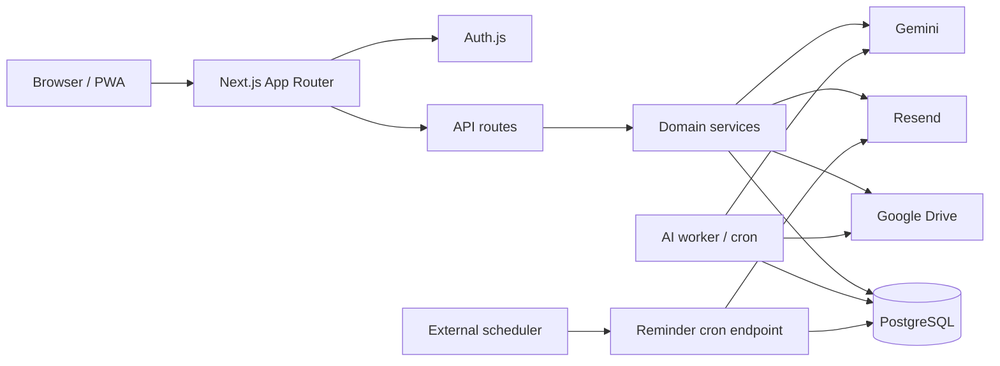

# Vaulty

**A private workspace for your important documents, credentials, wealth records, and reminders.**

Vaulty brings personal information into one place: organize important files, understand them with AI, keep track of accounts and transactions, manage a credential vault, share selected areas with family, and stay ahead of important dates.

> **Project status:** Active development. Review the [known limitations](.agents/PRODUCT.md#not-implemented--do-not-advertise-as-current) and [security notes](.agents/ARCHITECTURE.md#4-security--cryptography-model) before deploying with real personal data.

## Contents

- [Features](#features)
- [Screens and modules](#screens-and-modules)
- [Technology stack](#technology-stack)
- [Architecture](#architecture)
- [Getting started](#getting-started)
- [Environment configuration](#environment-configuration)
- [Available scripts](#available-scripts)
- [Database and migrations](#database-and-migrations)
- [Background processing and reminders](#background-processing-and-reminders)
- [Documentation for developers and AI agents](#documentation-for-developers-and-ai-agents)
- [Security and privacy](#security-and-privacy)
- [Testing](#testing)
- [Contributing](#contributing)
- [License](#license)

## Features

### Document management

- Upload PDF, JPEG, PNG, and WebP files.
- Quick mobile camera capture with interactive 4-corner perspective cropping, document enhancement filters, multi-page scanning with PDF stitching, and automatic client-side compression before uploading to Google Drive.
- Append new pages directly to existing documents in Google Drive, automatically re-running Gemini AI extraction across all pages.
- Organize documents with nested folders and tags.
- Preview, search, download, rename, move, and delete documents.
- Record document expiry dates.
- Create public share links with optional password protection, expiry, and view limits.
- Share folders read-only with other Vaulty users.

### AI document understanding

- Explicitly request AI processing for a document.
- Extract document text and generate Markdown summary and interpretation.
- Persist processing jobs with retry and stale-job recovery.
- Store original documents and generated AI artifacts in Google Drive.

### Credential vault

- Store app and bank credentials in a separate vault.
- Protect credential payloads with browser-side Web Crypto encryption.
- Protect the entire application with centralized App Lock (PIN/passkey, with the existing master-password fallback).
- Configure offline recovery material.
- Manage credential sharing exclusively through Family module permissions; the Credentials page has no standalone share action.

### Wealth tracking

- Track bank accounts, credit cards, investments, loans, deposits, cash, and other asset/liability types.
- Record transactions and account balances.
- Review net-worth and account breakdowns grouped independently by currency; no mixed-currency aggregation or implicit conversion.
- Upload, parse, review, and import financial statements.
- Connect Gmail or Outlook to discover potential transactions. Local relevance ranking filters promotional/personal emails before AI parsing (maximum 30 selected messages); account last-four matching can preselect a Wealth account, and duplicate fingerprints are checked before review insertion.

### Reminders and notifications

- Create one-time and recurring reminders.
- Track document expiry and Wealth account expiry.
- Derive credit-card payment reminders from the configured due day.
- Configure in-app and email notification preferences.
- Extract explicitly printed expiry and financial deadline dates during Gemini analysis, with confidence/evidence. High-confidence dates can create reminders; existing manually entered expiry dates are never overwritten.
- Send notifications through in-app, email, and Web Push channels. Notification cards navigate from the full card surface when an action URL exists; browser push works per subscribed device/browser where supported.

### Family sharing

- Invite family members by email.
- Choose document, wealth, and credential modules independently.
- Provide read-only access and revoke/update membership permissions.

### AI chat

- Chat with Gemini using the document-grounded context provided by the application.

## Screens and modules

| Route                       | Purpose                                                            |
| --------------------------- | ------------------------------------------------------------------ |
| `/`                         | Public product landing page                                        |
| `/dashboard`                | Personal workspace overview and upcoming attention items           |
| `/documents`                | Document overview                                                  |
| `/documents/library`        | Document library                                                   |
| `/folders`                  | Folder navigation                                                  |
| `/credentials`              | Credential vault overview                                          |
| `/credentials/account`      | App login credentials                                              |
| `/credentials/bank`         | Bank credentials                                                   |
| `/wealth`                   | Wealth overview                                                    |
| `/wealth/accounts`          | Wealth accounts                                                    |
| `/wealth/transactions`      | Transactions                                                       |
| `/wealth/statements/import` | Statement import                                                   |
| `/email-sync`               | Gmail and Outlook multi-module discovery (wealth, docs, reminders) |
| `/reminders`                | Custom reminders and preferences (list view)                       |
| `/reminders/calendar-view`  | Reminders calendar view                                            |
| `/notifications`            | In-app notification center                                         |
| `/family`                   | Family invitations and shared modules                              |
| `/shared`                   | Items shared with the signed-in user                               |
| `/search`                   | Search                                                             |
| `/chat`                     | AI chat                                                            |
| `/settings`                 | Profile, security, storage, AI and account settings                |

## Technology stack

- **Framework:** Next.js 16.4.5 App Router
- **Language:** TypeScript (strict mode)
- **UI:** React 19.2.8, Tailwind CSS v4, Lucide React
- **Theme:** `next-themes`
- **Authentication:** Auth.js v5 beta, Google OAuth and email magic links
- **Database/ORM:** PostgreSQL and Prisma 6
- **File storage:** Google Drive API
- **AI:** Google Gemini (`@google/genai`)
- **Email:** Resend SMTP via Nodemailer
- **Tests:** Vitest, Playwright
- **Browser push:** `web-push` (VAPID signing and RFC 8291 payload encryption)
- **Package manager:** Yarn 4.5.3

## Architecture



PostgreSQL stores users, ownership, document metadata, AI job state, Wealth records, credential ciphertext, reminders, notifications, sharing, and audit/rate-limit state. Google Drive stores source document binaries and generated AI artifacts.

**Storage note:** Google Drive is the only implemented storage provider. The provider interface/factory is an abstraction boundary, not evidence of additional provider support.

## Getting started

### Prerequisites

- Node.js version supported by Next.js 16.4.5.
- Corepack and Yarn 4.5.3.
- A PostgreSQL database.
- Google Cloud OAuth credentials.
- Gemini API key for AI functionality.
- Resend account/API key for email delivery.
- Microsoft Entra app only if Outlook email transaction import is needed.

### 1. Clone and install

```bash
git clone <your-repository-url>
cd vaulty

corepack enable
yarn install
```

### 2. Configure environment

```bash
cp .env.example .env
```

Fill in the required values. See [Environment configuration](#environment-configuration) and [.agents/DEVELOPMENT.md](.agents/DEVELOPMENT.md).

### 3. Generate Prisma Client and apply migrations

```bash
yarn prisma generate
yarn db:migrate
```

For a fresh local database, `yarn db:migrate` creates/applies the development migration history. Do not use `prisma migrate reset` on a database containing data you need.

### 4. Start the development server

```bash
yarn dev
```

Open `http://localhost:3000`. Run `yarn install` after dependency changes and commit the refreshed `yarn.lock`; the lockfile must match `package.json` before using immutable installs.

## Environment configuration

The `.env.example` file lists the primary variables. Common configuration:

| Variable                                          | Description                                                                                                                              |
| ------------------------------------------------- | ---------------------------------------------------------------------------------------------------------------------------------------- |
| `DATABASE_URL`                                    | PostgreSQL connection string                                                                                                             |
| `AUTH_SECRET`                                     | Auth.js secret; also derives encryption keys for stored Gmail/Outlook refresh tokens                                                     |
| `NEXTAUTH_URL`                                    | Canonical application URL and OAuth callback base                                                                                        |
| `GOOGLE_CLIENT_ID` / `GOOGLE_CLIENT_SECRET`       | Google sign-in, Drive and Gmail OAuth                                                                                                    |
| `GEMINI_API_KEY`                                  | Gemini API key                                                                                                                           |
| `GEMINI_MODEL`                                    | Optional Gemini model override; source default is `gemini-3.6-flash`                                                                     |
| `RESEND_API_KEY`                                  | Resend API key                                                                                                                           |
| `EMAIL_FROM`                                      | Verified sender address                                                                                                                  |
| `NEXT_PUBLIC_APP_URL`                             | Absolute application links used by selected flows                                                                                        |
| `MAX_UPLOAD_SIZE`                                 | Maximum upload size in bytes; default 50 MiB                                                                                             |
| `CRON_SECRET`                                     | Bearer secret for authenticated cron endpoints; minimum 32 characters                                                                    |
| `CSRF_SECRET`                                     | Required in production; dedicated HMAC-SHA256 CSRF signing secret of at least 32 characters. Development may fall back to `AUTH_SECRET`. |
| `MICROSOFT_CLIENT_ID` / `MICROSOFT_CLIENT_SECRET` | Optional Outlook personal mailbox integration                                                                                            |
| `MICROSOFT_TENANT_ID`                             | Outlook tenant; defaults to `consumers`                                                                                                  |
| `ADMIN_EMAILS`                                    | Comma-separated admin allowlist; unset means no admin access                                                                             |

AI worker tuning variables are documented in [.agents/DEVELOPMENT.md](.agents/DEVELOPMENT.md). In production, `CSRF_SECRET` is mandatory, must be dedicated to CSRF signing, and must contain at least 32 characters; it does not fall back to `AUTH_SECRET`. Never commit `.env` or real secrets. Generate a dedicated secret with `node -e "console.log(require('node:crypto').randomBytes(32).toString('base64url'))"` and set it as `CSRF_SECRET` in every production environment.

### OAuth callback URLs

For each configured application origin, register the exact callback URLs:

- Google sign-in: `/api/auth/callback/google`
- Google Drive: `/api/integrations/google-drive/callback`
- Gmail: `/api/integrations/gmail/callback`
- Outlook: `/api/integrations/outlook/callback`

Gmail requires incremental read-only Gmail permission. Outlook uses a separate Microsoft Entra app with delegated `Mail.Read`, `User.Read`, and `offline_access` permissions.

## Available scripts

```bash
yarn dev             # Development server
yarn build           # Prisma generate + Next.js production build
yarn start           # Start production server
yarn lint            # ESLint
yarn lint:fix        # ESLint with fixes
yarn type-check      # TypeScript check
yarn test            # Vitest unit tests
yarn test:watch      # Vitest watch mode
yarn test:e2e        # Playwright browser tests
yarn playwright:install # Install Chromium and OS dependencies
yarn ai:worker        # Run standalone AI queue worker
yarn db:generate      # Generate Prisma Client
yarn db:migrate       # Prisma migrate dev
yarn db:push          # Prisma db push (development/prototyping only)
yarn db:studio        # Prisma Studio
yarn db:seed          # Run seed script
yarn vercel-build     # Prisma generate + migrate deploy + Next build
yarn prettier:fix     # Format project
```

## Database and migrations

- Prisma schema: `prisma/schema.prisma`.
- Migration history: `prisma/migrations/`.
- Seed: `prisma/seed.ts`.
- Local migration: `yarn db:migrate`.
- Production migration: `yarn prisma migrate deploy`.
- Inspect migration state: `yarn prisma migrate status`.

Back up production before schema changes. Do not edit historical migrations that may already have been applied. For migration failure recovery, inspect actual database state and migration SQL before using `prisma migrate resolve`.

## Background processing and reminders

### AI document jobs

AI jobs are persisted in PostgreSQL and processed by the standalone worker:

```bash
yarn ai:worker
```

Alternatively call `GET` or `POST /api/cron/ai-worker` with:

```http
Authorization: Bearer <CRON_SECRET>
```

### Reminder notifications

The reminder processor is exposed at `GET /api/cron/reminders` and requires the `Authorization: Bearer $CRON_SECRET` header. The checked-in Vercel cron invokes it daily at 03:30 UTC (09:00 IST).

For non-Vercel hosting, configure an external daily scheduler for this endpoint. Vercel cron availability and execution frequency depend on your Vercel plan. The cron endpoint remains protected by `CRON_SECRET`.

Current notification channels are in-app, email, and browser push. Browser push requires VAPID configuration and user opt-in on each browser/device. See [.agents/PRODUCT.md](.agents/PRODUCT.md), [.agents/DEVELOPMENT.md](.agents/DEVELOPMENT.md), and [.agents/ARCHITECTURE.md](.agents/ARCHITECTURE.md).

### Browser push setup

Generate a VAPID P-256 key pair using Node.js:

```bash
node -e "const c=require('node:crypto').createECDH('prime256v1');c.generateKeys();console.log('NEXT_PUBLIC_VAPID_PUBLIC_KEY='+c.getPublicKey().toString('base64url'));console.log('VAPID_PRIVATE_KEY='+c.getPrivateKey().toString('base64url'))"
```

Set `NEXT_PUBLIC_VAPID_PUBLIC_KEY`, `VAPID_PRIVATE_KEY`, and `WEB_PUSH_SUBJECT` (a `mailto:` contact or HTTPS URL) in the deployment environment. Delivery uses the maintained `web-push` package for VAPID signing and Web Push payload encryption. Apply the Prisma migration, then users can enable browser push from the Notifications page. Push is sent to active subscriptions for a user; expired browser subscriptions (HTTP 404/410) are removed. The service worker is `public/sw.js`. HTTPS is required outside localhost.

### Automatic document date extraction

When document AI processing runs, Gemini extracts document type, explicit expiry dates, and important dates such as insurance premium due dates, policy renewals, payment due dates, and subscription end dates with confidence/evidence. Vaulty stores this structured metadata on `AiProcessing`. High-confidence important dates create deduplicated standard reminders; expiry metadata is applied only when the date is a valid ISO calendar date, confidence is at least 0.85, evidence is present, and no expiry date has already been entered manually. If AI is disabled or the document has not been processed, dates must be entered manually. Never infer dates from policy duration or assumptions; users should verify AI suggestions.

## Documentation for developers and AI agents

Detailed project guidance is maintained in [`.agents/`](.agents/AGENTS.md).

| Document                                               | Contents                                                                             |
| ------------------------------------------------------ | ------------------------------------------------------------------------------------ |
| [AGENTS.md](.agents/AGENTS.md)                         | Central entry point, repository map, core engineering rules, and safe workflow       |
| [PRODUCT.md](.agents/PRODUCT.md)                       | Product positioning, implemented modules, complete business workflows, and routes    |
| [ARCHITECTURE.md](.agents/ARCHITECTURE.md)             | Runtime topology, external integrations (Drive, Gemini, Mail, Push), and security    |
| [DATA_MODEL.md](.agents/DATA_MODEL.md)                 | Prisma schema, model inventory, enums, performance compound indexes, and migrations  |
| [API.md](.agents/API.md)                               | Exhaustive API route inventory, request/response formats, CSRF, and rate limits      |
| [DEVELOPMENT.md](.agents/DEVELOPMENT.md)               | Setup, environment variables, scripts, workers, automated tests, and troubleshooting |
| [CODING_CONVENTIONS.md](.agents/CODING_CONVENTIONS.md) | Codebase standards, server/client boundaries, UI/UX visual design system, and a11y   |

**Agent instruction:** Before implementing a feature, read `AGENTS.md` and the relevant domain reference. Keep documentation and `.env.example` synchronized with code changes.

## Security and privacy

Vaulty handles sensitive personal information. Use HTTPS in production, keep secrets in a deployment secret manager, apply database least privilege, back up PostgreSQL securely, and review OAuth provider requirements.

Important caveats:

- Credential payloads use client-side encryption; this does not mean every document or database field is end-to-end encrypted.
- Google Drive OAuth tokens and other sensitive metadata are stored in PostgreSQL.
- The credential vault has known key-extractability and recovery limitations.
- App Lock passkey convenience is not server-verified WebAuthn authentication.
- Gmail access uses a restricted read-only scope and may require provider verification/security assessment.
- No independent penetration test or formal security certification is represented.
- Read [`.agents/ARCHITECTURE.md`](.agents/ARCHITECTURE.md#4-security--cryptography-model) before using production personal data. Report vulnerabilities privately to the project maintainer rather than opening public issues with exploit details.

## Testing

Run:

```bash
yarn prisma generate
yarn type-check
yarn lint
yarn test
yarn playwright:install
yarn test:e2e
yarn build
```

The repository contains 31 Vitest unit and integration test suites (238 tests) and a Playwright Chromium E2E suite for the public landing page, sign-in entry point, and unauthenticated route protection. Run `yarn playwright:install` before `yarn test:e2e`. External OAuth and provider flows still require configured test applications and manual verification. GitHub Actions runs the Playwright suite, while CodeQL performs scheduled and pull-request static security analysis. The dependency manifest now includes `web-push`, `@types/web-push`, and `@playwright/test`; refresh and commit `yarn.lock` with `yarn install` before enabling immutable installs. See [`.agents/DEVELOPMENT.md`](.agents/DEVELOPMENT.md#5-testing--quality-assurance).

## Contributing

Contributions should preserve the existing stack and security boundaries.

1. Open an issue or discuss a significant change before starting large work.
2. Create a focused branch.
3. Follow [`.agents/AGENTS.md`](.agents/AGENTS.md) and [`.agents/CODING_CONVENTIONS.md`](.agents/CODING_CONVENTIONS.md).
4. Add or update tests for behavior changes.
5. Update `.agents/` documentation and `.env.example` when behavior/configuration changes.
6. Run type-check, lint, tests, and build where practical.
7. Submit a pull request with a concise description, testing evidence, migration notes, and screenshots for UI changes.

Do not include secrets, real personal documents, database dumps, or production user data in issues or pull requests.

## License

No `LICENSE` file is present in this repository archive. The project does not currently declare an open-source license. Do not assume permission to use, modify, or redistribute it until the maintainer adds a license.

## Recent implementation notes — PDF statements and date review

- Financial email sync downloads statement PDFs only from locally selected statement-like Gmail/Outlook messages. The server extracts PDF text locally and places heuristic transaction rows into the existing review queue.
- PDF password values and institution templates are configured in Settings → Security → Financial PDF password templates. `PdfPasswordSettings.encryptedConfig` is AES-256-GCM encrypted; set `PDF_PASSWORD_SETTINGS_SECRET` (32+ chars) or retain a stable `AUTH_SECRET`. Do not rotate the key without a migration.
- Supported template tokens: `{{firstName}}`, `{{lastName}}`, `{{mobile}}`, `{{dateOfBirth}}`, `{{pan}}`, and user-defined custom tokens. Missing token values cause that template to be skipped. Explicit email password hints are tried first; candidate attempts are capped at eight.
- PDF attachments are not sent to Gemini. Scanned/image-only PDFs are not OCRed by this email path; users should manually import/review them.
- Document owners can correct or clear extracted expiry and important dates in Document Details. The API rebuilds reminders and rejects non-owner/CSRF-invalid requests.
- Newly stored browser push subscription keys are encrypted at rest. iOS/iPadOS Web Push requires the PWA to be installed to the Home Screen and iOS/iPadOS 16.4+; Android/browser support depends on PushManager availability.
